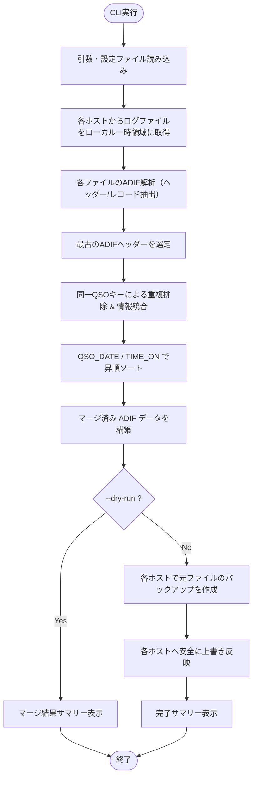

# merge_wsjtx_log 設計書

複数端末に分散している WSJT-X のログファイル（ADIF形式: `wsjtx_log.adi`）を自動取得し、安全にマージ・ソート・重複排除した上で、対象ホストへ書き戻す同期ツールです。

---

## 1. 概要と目的

WSJT-X を複数のPCで運用している場合、交信ログが各PCに分散・断片化します。手作業によるマージではレコードの並び順の崩れや重複が生じやすく、管理が煩雑になります。

本ツールは以下の目的を達成します：
- リモートホストから最新のログファイルを自動取得
- ADIF仕様に基づいたヘッダー抽出、レコードの重複排除、および交信日時順ソート
- 障害・データ消失を防ぐ自動バックアップ機構
- 整理・統合された最新ログファイルで対象ホスト群を一括同期

---

## 2. システム要件・前提条件

- **実行環境**: Python 3.8 以上（外部依存ライブラリ不要、標準ライブラリのみで動作）
- **通信・認証**: 
  - OS標準の `ssh` コマンドを使用（標準入力パイプ転送による高信頼なファイル同期）
  - 対象ホストに対してSSH公開鍵認証等でパスワードレス接続が可能であること（`~/.ssh/config` の設定を推奨）
- **対象プラットフォーム**: macOS, Linux

---

## 3. 対象ファイル仕様

デフォルトで以下の3箇所のログファイルを対象とします（設定ファイルまたはCLI引数で変更・追加可能）。

1. `host1.local:/home/username/.local/share/WSJT-X/wsjtx_log.adi`
2. `host2.local:/Users/username/Library/Application Support/WSJT-X/wsjtx_log.adi`
3. `host2.local:/Users/username/Library/Application Support/WS/wsjtx_log.adi`

※ローカル・リモートを問わず、`[user@]host:path` またはローカル絶対パスの双方に対応します。

---

## 4. 機能仕様

### 4.1 ADIF パース & シリアライズ
- ADIF（Amateur Data Interchange Format）標準に準拠。
- ファイルを **ヘッダー部**（`<EOH>` より前）と **レコード部**（`<EOR>` で区切られた各QSO）に分割して解釈。
- タグ名（例: `<CALL:5>`, `<call:5>`）の大文字小文字を正規化して処理。

### 4.2 ヘッダー選定仕様
- 取得した各ファイルのADIFヘッダーを比較。
- ヘッダー内の `<CREATED_TIMESTAMP:...>` タグの日時を比較し、**最も古い日時のヘッダー** を採用。
  - 当該タグが存在しない、または解析不能な場合は、ファイルの更新日時（mtime）が最も古いものを採用。

### 4.3 レコード重複排除仕様
- **同一QSO（重複）判定キー**:
  - `CALL`（相手局コールサイン）
  - `QSO_DATE`（交信日付: YYYYMMDD）
  - `TIME_ON`（交信開始時刻: HHMMSS または HHMM）
  - `BAND` または `FREQ`（周波数帯 / 周波数）
  - `MODE`（交信モード: FT8, FT4 等）
- **重複時の優先ルール**:
  - 上記キーが完全一致するレコードが複数存在する場合、**保持するフィールド数が多い（情報量が多い）レコード** を優先して残します。

### 4.4 レコードソート仕様
- マージおよび重複排除後のレコード群を以下の優先順位で昇順ソートします：
  1. `QSO_DATE`（昇順）
  2. `TIME_ON`（昇順）

### 4.5 安全対策・バックアップ仕様
- **リモートバックアップ**:
  - 各ホストへの上書き保存直前に、対象ホスト側の同ディレクトリ内に `wsjtx_log.adi.bak_YYYYMMDD_HHMMSS` を自動生成。
- **アトミック更新**:
  - 一時ファイルとしてアップロード後にリネーム（置換）を行い、転送中の切断等によるファイル破損を防止。
- **Dry-run モード**:
  - 実際のファイル書き換えを行わず、取得・パース・重複排除・ソート結果のプレビュー（元件数、重複件数、最終件数）を確認可能。

---

## 5. 処理フロー



---

## 6. プロジェクト構成案

```text
merge_wsjtx_log/
├── README.md               # 本設計書
├── config.json             # デフォルト対象ホスト・パス設定
├── merge_wsjtx_log.py      # メイン実行スクリプト（CLI・ワークフロー制御）
├── adif_handler.py         # ADIFパーサー・シリアライザー・マージエンジン
├── remote_sync.py          # SSH/SCP操作・バックアップ・同期処理
└── tests/
    ├── test_adif_handler.py # ADIFパース、重複排除、ソートの単体テスト
    └── sample_logs/         # テスト用ダミーADIFファイル
```

---

## 7. コマンドラインインターフェース（CLI仕様）

```bash
# 1. 通常実行（config.jsonの設定対象をマージして双方へ反映）
python3 merge_wsjtx_log.py

# 2. 事前確認（ファイルの書き換えを行わずに件数・差分を確認）
python3 merge_wsjtx_log.py --dry-run

# 3. 対象ファイルを指定して実行
python3 merge_wsjtx_log.py \
  w541u.local:/home/shitoh/.local/share/WSJT-X/wsjtx_log.adi \
  "m1p.local:/Users/shitoh/Library/Application Support/WS/wsjtx_log.adi"

# 4. マージ結果をローカルファイルに出力（リモート上書きなし）
python3 merge_wsjtx_log.py --output ./merged_wsjtx_log.adi
```

---

## 8. ライセンス

[MIT License](LICENSE) © 2026 andantino190 (JM1NOE)
